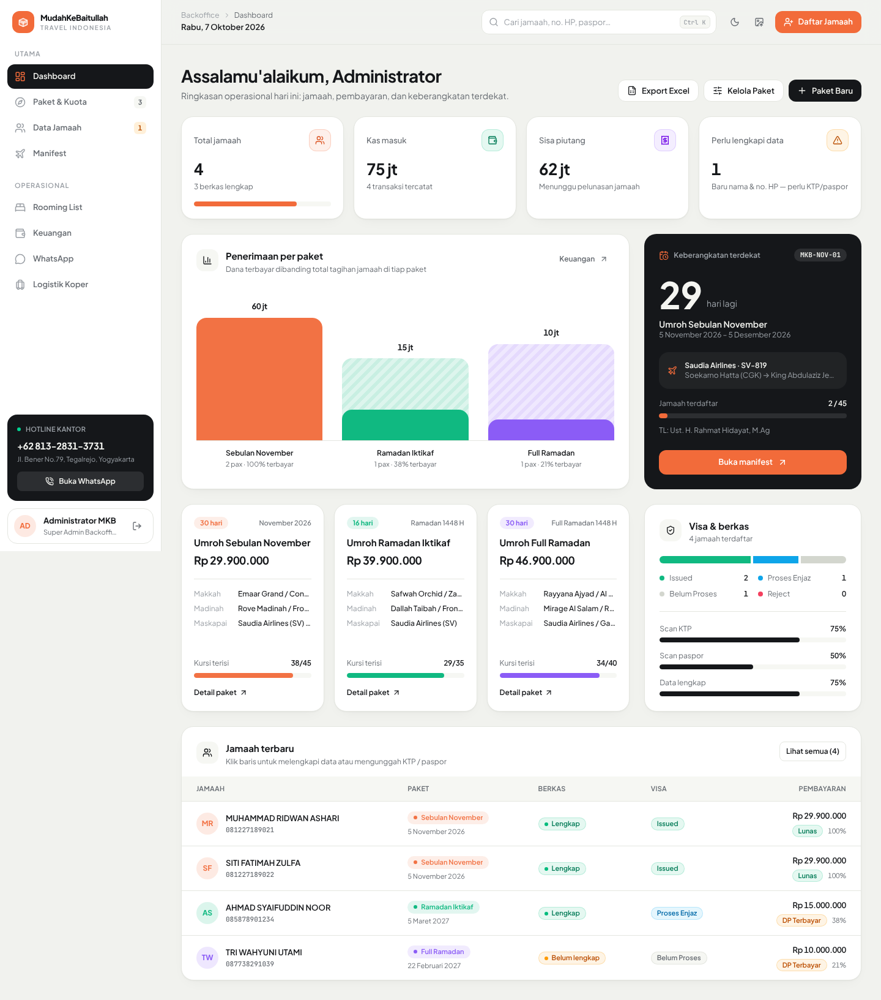
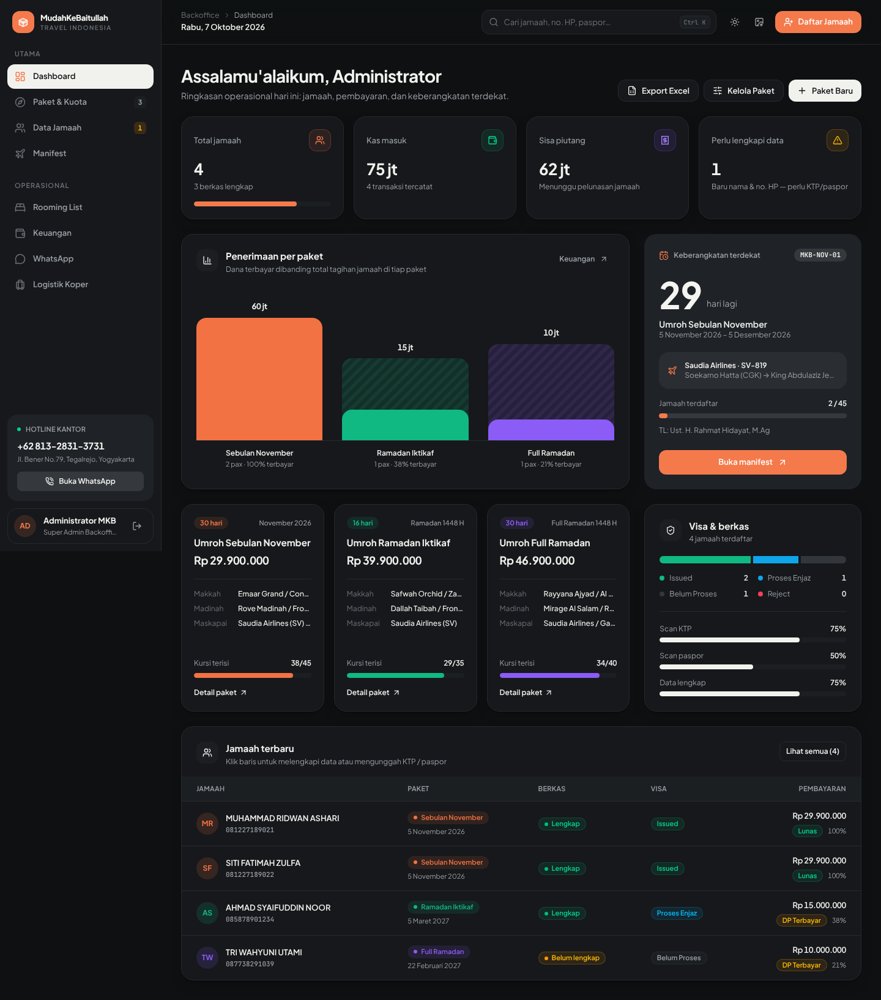

# MKB Backoffice

Sistem backoffice & operasional umroh PT Mudahkebaitullah Travel Indonesia (Yogyakarta):
paket & kuota, database jamaah, manifest penerbangan, rooming list, keuangan & kwitansi,
WhatsApp center, serta logistik koper.

```bash
npm install
npm run dev     # http://localhost:3000  (login: admin / adminmkb)
npm run build
npm run lint    # typecheck
```

Data disimpan di `localStorage` browser (belum ada backend).

## Struktur UI

- `src/index.css` — design token (warna, radius, bayangan) untuk tema terang & gelap, plus kelas komponen dasar.
- `src/components/ui.tsx` — komponen dasar: `Card`, `Button`, `Badge`, `StatCard`, `Modal`, `Field`, `Segmented`, dll.
- `src/components/<modul>/` — satu folder per halaman; `src/components/modals/` — dialog global.

## Tampilan



